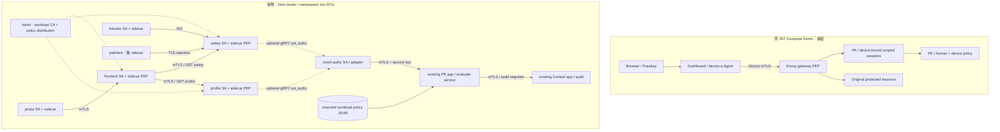

# 207 → 207A：Kubernetes / Istio Sidecar Demo

本擴充保留原本 Compose Demo：Passkey / Device X.509 → Envoy gateway → PA → PE
與 Dashboard 都維持原路徑。另以獨立 kind cluster `zta-207a` 示範服務間身分與授權，
不需要搬動原本的 DB、憑證、瀏覽器 Passkey 或正在執行的容器。

這是一個 **workload-only** 教學擴充。`alice` 與薪資內容都是 synthetic fixture，
不是登入使用者；frontend 不接受或轉送 human token。原 207 的 human/device 證據不會
被假造為 mesh 身分。若要同一條交易結合兩者，仍需設計受保護的 gateway bridge、
短效 JWT 的簽發／audience／交換與各 hop 驗證，這次不宣稱完成該範圍。

## 架構



實線為資料或檢查請求；虛線包含控制平面配置與可選授權呼叫。原 207 與新增 mesh
是兩個可分別執行的 Demo，不存在隱藏的跨環境認證捷徑。

| 元件 | 執行方式與責任 |
|---|---|
| frontend / salary / profile | 三個 FastAPI Deployment / ClusterIP Service，分開的 ServiceAccount |
| Sidecar Envoy PEP | 每個注入的 Pod 執行，攔截服務 port 8000；應用程式不解析可信身分標頭 |
| Istiod | 簽發帶 SPIFFE URI SAN 的 workload X.509 憑證、輪替、分發政策；不是 SPIRE |
| PeerAuthentication | namespace `STRICT`：不允許非 mesh plaintext 呼叫 |
| AuthorizationPolicy | namespace default deny；精確 principal + port + GET + path |
| DestinationRule | `ISTIO_MUTUAL`，最長連線時間 1800 秒；憑證 TTL 設為 1 小時 |
| optional mesh-authz | Envoy v3 gRPC，從 source/destination principal 取身分，忽略偽造 XFCC／subject |
| optional PE / Context | 重用原 application，以獨立 Deployment 與 state 執行；workload policy 和 user/device score 分開 |

原 PA 管理 human/device session，沒有被替換。Mesh 原生授權由 Istio 宣告政策分發；
可選 adapter 把每次 backend 請求送到 PE 的 `/evaluate-service`。CUSTOM 與原生 ALLOW
都必須通過，PE ALLOW 無法放寬原生 method/path/principal 限制。

## 前置條件與版本

- Docker Desktop Linux containers / Docker Engine，建議配置至少 4 CPU、8 GiB RAM，
  第一次需下載 node、Istio 與 Python images；與原 Demo 同時執行需更多記憶體。
- Python 3.12、kubectl、**kind v0.33.0**、**istioctl 1.31.1**；node image 固定
  `kindest/node:v1.35.0`。1.31.1 版本與支援矩陣見官方來源；升版應重新跑完整驗證。
- [kind 安裝](https://kind.sigs.k8s.io/docs/user/quick-start/)、
  [Istio 1.31.1 官方發行](https://github.com/istio/istio/releases/tag/1.31.1)、
  [Istio Kubernetes 支援矩陣](https://istio.io/latest/docs/releases/supported-releases/)。

工具需放入 PATH，或使用 `--kind /path/to/kind`、`--istioctl /path/to/istioctl`、
`--kubectl /path/to/kubectl`（必須放在 action 前面）。腳本不修改預設 kubeconfig；
固定 context `kind-zta-207a`，kubeconfig 保存在 git-ignored `.tmp/mesh-kubeconfig`。
不要把此專用 cluster 名稱用於其他資料或正式工作。

## 可重現部署

在 repository 根目錄，Windows PowerShell：

```powershell
python -m venv .venv
.\.venv\Scripts\python.exe -m pip install -r requirements-dev.txt -r requirements-mesh.txt
.\.venv\Scripts\python.exe scripts/mesh_demo.py up
.\.venv\Scripts\python.exe scripts/mesh_demo.py verify
.\.venv\Scripts\python.exe scripts/mesh_demo.py status
```

Linux/macOS 使用 `.venv/bin/python` 取代 `.\.venv\Scripts\python.exe`。`up` 建立／重用
專用 cluster、build 非 root image、載入 image、安裝最小 Istio、先配置 STRICT/default-deny，
再部署應用。重跑會更新 Pods，使本機同名 image 的新程式生效。第一次 image 下載可能較久。

驗證程式從注入 sidecar 的 probe 呼叫 frontend，由 frontend 分別呼叫 salary/profile。
它也驗證 active certificate 中的 SPIFFE SAN 與到期時間，不會輸出 private key。
結果寫入 `artifacts/mesh-base.json`；失敗會以非零退出並保留已完成的證據。

| 實際請求／操作 | 預期 |
|---|---|
| probe → frontend → salary/profile | 200，確認真正 backend JSON |
| frontend → salary `/api/salary?trace=1` | 200，query 不改變授權 path |
| intruder → salary，或 probe 直接 → salary | 403，即使同 namespace 或已有合法 mesh 憑證 |
| frontend POST /api/salary、GET /api/profile 到 salary | 403，不能擴大 method/path |
| intruder 偽造 XFCC、x-zta-subject、x-zta-session | 403 |
| intruder GET /health | 403，無隱含健康檢查授權 |
| plaintext → salary | TLS/連線失敗或 proxy 503；不能當成已授權 HTTP |
| intruder → salary Pod IP | 存取不成功；另確認正常 service 路徑仍成功（不單憑 503 判定是 routing、TLS 或 RBAC 哪一層拒絕） |
| 新增 DENY policy，再移除 | 403 → 200，展示 policy distribution |

若只想看 facade，可另開終端：

```powershell
kubectl --kubeconfig .tmp/mesh-kubeconfig --context kind-zta-207a -n zta-207a port-forward service/frontend 18081:8000 --address 127.0.0.1
```

瀏覽 [localhost:18081](http://localhost:18081)。**port-forward 是持有 kubeconfig 的管理者
通道，會繞過正常 inbound PEP**；這不是使用者入口認證測試。真正的授權證據來自上面的
in-mesh probe。沒有設定 public ingress、LoadBalancer 或 NodePort。

## 可選 PE ext_authz 整合

先完成 base 驗證，再執行：

```powershell
.\.venv\Scripts\python.exe scripts/mesh_demo.py --external-authz up
.\.venv\Scripts\python.exe scripts/mesh_demo.py --external-authz verify
```

結果另存 `artifacts/mesh-external.json`。此模式建立獨立的 Context、PE、gRPC adapter
與 random Kubernetes Secret。PE 的 `/evaluate-service` 受原本的 service key dependency
保護，且側車只允許 adapter SA 呼叫；adapter 本身只允許 salary/profile SA 呼叫。
正常 gRPC principal 是目的端代理傳入的 TLS metadata。此處 policy 信任的是整個
salary/profile Pod 與 ServiceAccount，無法區分同 Pod 的 proxy 與 application process；
那些 application 也能直接送出偽造 CheckRequest／audit claims。因此 native ALLOW
仍獨立約束真正 data-plane principal，adapter ALLOW 無法繞過它。若要將 backend
application compromise 納入威脅模型，必須再隔離／認證 proxy-to-adapter 通道。

`mesh/service-policy.json` 定義 source/destination SPIFFE URI、GET、exact path。
ConfigMap 以目錄 volume 掛載（不是不會更新的 subPath），PE 每次讀取並驗證政策。
驗證腳本實際更新 ConfigMap 為空 grants，等待投影更新，確認 403；恢復後確認 200，
不重啟 PE。Kubelet 投影與 Envoy policy update 都是 eventual consistency，沒有宣稱即時撤銷。

其他驗證依序把 adapter、PE、audit Context scale 到 0，確認每次 backend 存取拒絕，
再恢復到 1 並確認成功；因此僅能用於此專用 demo namespace。每項破壞性測試都有
`finally` 恢復。原 Compose 的 PE 與 Context 不受影響。HTTP 已完成回應無法追回；
服務範例沒有實作跨服務長連線 session 或原 PA 的 SSE 撤銷協定。

PE 在缺少政策、格式錯誤、讀檔失敗、audit 失敗時回 503；adapter 在無 authenticated
principal、PE denial、格式錯誤、timeout 或例外時拒絕。`failOpen: false` 保證 adapter
不可用也拒絕。Context 使用 emptyDir 作為可丟棄的 demo audit，重建 Pod 會清空，
正式用途應改成持久化且受保護的 audit 後端。

## 檢查與排錯

```powershell
kubectl --kubeconfig .tmp/mesh-kubeconfig --context kind-zta-207a -n zta-207a get pods
istioctl --kubeconfig .tmp/mesh-kubeconfig --context kind-zta-207a analyze -n zta-207a
istioctl --kubeconfig .tmp/mesh-kubeconfig --context kind-zta-207a proxy-status
kubectl --kubeconfig .tmp/mesh-kubeconfig --context kind-zta-207a -n zta-207a logs deployment/salary -c istio-proxy --tail=50
kubectl --kubeconfig .tmp/mesh-kubeconfig --context kind-zta-207a -n zta-207a logs deployment/mesh-authz -c app --tail=50
```

- 一般 application Pod 應有 `app` 和 `istio-proxy`，plaintext client 應只有 `app`。
- ImagePullBackOff：檢查 registry 連線與 Docker disk；Pending：查看資源／排程事件。
- 403：看 Envoy RBAC / ext_authz denied；503：看 TLS/upstream/PE/audit readiness。
- admission webhook 錯誤：先檢查 istiod Ready；不要把 injection 改為停用來繞過錯誤。
- `proxy-config secret -o json` 可能包含敏感資料；不要儲存或提交原始內容。
- `verify` 會修改此 namespace 的 demo policy 與 replicas；不要與其他展示操作同時跑。
- 要回到純 base 模式，先明確 `down` 再 `up`；base `up` 不會偷偷拆除已啟用的 CUSTOM。

單元／service contract／真正 gRPC transport 測試：

```powershell
.\.venv\Scripts\python.exe -m pytest -q
```

安裝 `requirements-mesh.txt` 後才會執行 adapter 測試；只有原始 dependencies 時會跳過。
GitHub Actions `Verify 207A Mesh` 安裝兩組 dependencies 並跑完整 suite、base mesh 和
external mesh。原 `Verify ZTA Demo` workflow 保留，繼續驗證 Compose／Envoy／WebAuthn。
實測結果與限制見 [207A verification](207a-verification.md)。

## Network tier、信任邊界與未完成項目

207A 的 network tier 與 identity tier 應並存。Base cluster 的 kindnet **不執行 Kubernetes
NetworkPolicy**，因此 base 的拒絕證據屬於 Istio mTLS／AuthorizationPolicy，不把 YAML
存在本身當作網路隔離的證據。`mesh/network-policy.yaml` 是另備的 namespace ingress
邊界範例，僅應在具有 enforcing CNI 的環境套用並補測；egress、DNS、istiod、metrics、
ingress gateway 規則需依實際環境設計，這次沒有驗證那些規則。

擁有 cluster-admin、kubectl exec/port-forward、Docker/root、能修改 Pod/ServiceAccount
或 sidecar 的人都在此信任邊界外。沒有宣稱抵抗同 Pod 的 root compromise；未部署
Pod Security admission、最小操作員 RBAC、企業 enrollment、集中監控或 HA。

| NIST 來源 | 對應與實際範圍 |
|---|---|
| SP 800-207 §3.1、§3.2.1、§3.3 | 原 human/device PE/PA/PEP、gateway、trust algorithm 保留 |
| SP 800-207A §1.2 | 採 sidecar service mesh，未使用 ambient 替代此 reference model |
| §3.1 ID-SEG-REC-1/2 | STRICT mTLS、per-SA SPIFFE X.509、Istiod 簽發與輪替配置；未做跨 TTL 長時間輪替測試 |
| §3.1 ID-SEG-REC-3、§4.2–4.3 | 宣告式 granular service policy；可選 external decision |
| §3.1 ID-SEG-REC-4/5 | mesh 內每 hop 的 end-user token／resource authorization **未實作**；原 Passkey Demo 另行保留 |
| §3.3、§4.6 | network + identity tier；identity 已驗證，enforcing-CNI network tier 尚未驗證 |
| §4.6.2–4.6.3 | workload identity、service discovery、policy as code；不宣稱安裝 SPIRE |
| §4.7 monitoring | Envoy access logs + PE/audit events；非完整 enterprise monitoring framework |

**Multi-Cluster / Multi-Cloud 本次不部署。** 下一階段至少需要兩個可用叢集、共享或聯邦
CA/trust domains、east-west gateway、remote discovery credentials、清楚的 network
segmentation 與跨 cluster 正向／負向測試。單 cluster 的設定不構成 multi-location 驗證。
這是 NIST 概念對應的可執行教學，不是認證或完整標準符合性聲明。

來源：使用者提供的 [NIST SP 800-207](https://doi.org/10.6028/NIST.SP.800-207)、
[NIST SP 800-207A](https://doi.org/10.6028/NIST.SP.800-207A)，以及
[Istio AuthorizationPolicy](https://istio.io/latest/docs/reference/config/security/authorization-policy/)、
[Istio external authorization](https://istio.io/latest/docs/tasks/security/authorization/authz-custom/)。

## 停止與明確清除

```powershell
.\.venv\Scripts\python.exe scripts/mesh_demo.py down
```

這會永久刪除 **專用 kind cluster `zta-207a`** 與其中全部 demo Secret、ConfigMap、
Pod 和 emptyDir state；不刪除原 Compose stack、其 volumes 或原 repo 檔案。
已輸出的 `artifacts/mesh-*.json` 保留供檢查，不含 token、private key 或 kubeconfig。
