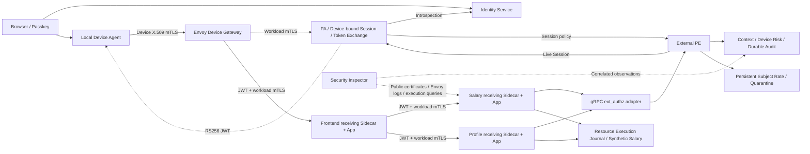

# Zero Trust Security Inspector — Windows 操作與驗證

這是單一 kind Cluster 的企業人事／薪資研究原型。資料與帳號配置為 Synthetic Data；Passkey 簽章驗證、裝置 mTLS、JWT、Istio Workload Identity、資源授權與故障阻擋均由真實元件執行。Phase 2 / Multi-Location 未實作。

[2026-10-23 CI 修復、Windows Hello 人工驗收與冷啟動檢查](ci-transport-2026-10-23.md)

## 啟動

前提：Docker Desktop Linux containers、Python 3.12、kubectl、kind v0.33.0、istioctl 1.31.1。現有工作區的 `.tools` 會自動優先使用；其他環境可將工具加入 PATH。Repo 需有 `.venv`；初次建立可用 `py -3.12 -m venv .venv`。

```powershell
# 一鍵安裝依賴、部署隔離原型、啟動本機 Inspector
scripts\start_identity.cmd

# 另外執行 Python + 真實 K8s / Istio / mTLS 整合驗證
scripts\start_identity.cmd --verify

# 已部署時只啟動 Inspector
.\.venv\Scripts\python.exe scripts/security_inspector.py
```

可直接雙擊 scripts/start_identity.cmd；它使用 Python 啟動器，不修改 Windows Execution Policy。ps1 wrapper 僅供允許腳本的環境選用。

網址固定 **http://localhost:18081/**，請使用支援 WebAuthn 的 Chrome / Edge。`127.0.0.1` 不等於 WebAuthn 的 localhost Origin。Inspector 使用 loopback 18081；由它管理的 port-forward 使用 18082（Identity）與 18443（Device Envoy）。占用這些 Port 的其他程式不會被自動終止。

選 Alice 或 Bob，先按「註冊 Passkey」，再按「Passkey 登入」。註冊按鈕代表本機管理者為預先配置的帳號發出一次性、五分鐘有效邀請；可新增硬體 Passkey，不會刪除既有憑證。瀏覽器無法改 Role。Identity 保留匿名首次 Alice 註冊，以相容原 207；新 Inspector 的註冊均使用管理者邀請。

登入後會透過真正的 Device X.509 Gateway 建立 PA Session 並交換 JWT。JWT 最長 120 秒，讀取 Scope 限定為 Session 的 Salary 或 Profile。薪資調整必須由 Bob 操作，透過真正 Passkey 再登入取得 60 秒內的 Authentication Assurance，交換最長 30 秒的 `salary:write`。

`scripts/mesh_console.py` 的預設入口已改為新的 Inspector。舊 `mesh_demo.py` 的 workload-only CLI 仍可用，但該模式不是整合式身分系統，也不應用於本次安全主張。

## 五個核心實驗

| 實驗 | 操作 | 預期觀測 |
|---|---|---|
| Alice 自己／他人薪資 | Alice 登入，Salary 擁有者先選 Alice，再選 Bob | 自己 200；Bob 403，PE reason `resource_ownership_denied`；遭拒 Attempt 執行紀錄為零 |
| 合法 JWT、非法 Workload | 已登入後選 Intruder 實驗 | 相同合法 User JWT 對 Alice 資源可通過 PE；Salary 接收端 Native Policy 仍拒絕 Intruder ServiceAccount，後端不執行。可直接展示 CUSTOM 與 Native 授權分工 |
| 偽造／無效身分 | 選偽造 Header、無效 JWT 或缺少 JWT | Header 不能取代 SPIFFE / 簽章；401／403。未抵達的元件沒有假 Trace；無 Log 時顯示未知 |
| HR 異常讀取 | Bob 登入，選 Alice，再選 HR 並行 8 次 | 短時間批量請求達門檻後隔離，後續 JWT 與真正 Step-Up 仍被拒。10 秒內最多 6 次為教學政策，非 NIST 指定值。恢復必須明確按「管理者操作 · 解除…行為隔離」 |
| PE 故障 Fail Closed | 先登入，選 PE 故障注入 | 僅隔離叢集 PE 暫停；請求 403／503，並直接查詢兩個後端的 SQLite 執行紀錄，確認該 Attempt 為零。自動恢復 PE；PA 持續評估可能已撤銷 Session，需重新登入 |

另外提供 Profile、前端 Pod 直接呼叫、無 Sidecar plaintext。敏感薪資調整將合成薪資設為 60,000，會產生真正持久化資料變更及執行紀錄。

## 架構



Istiod 為本機 Mesh 控制平面，配置工作負載憑證與 Native Policy；應用控制平面由 Identity／PA／PE／Context 組成。這是 §2 控制平面分工的本機原型，不代表已部署跨地點 Global / Local Control Planes。

```mermaid
sequenceDiagram
    participant User as Browser / Device Agent
    participant ID as Identity
    participant GW as Envoy Gateway
    participant PA
    participant FE as Frontend PEP + App
    participant BE as Salary receiving Sidecar
    participant PE as External PE
    participant C as Context + Audit
    participant DB as Salary App + Execution DB
    User->>ID: WebAuthn challenge / actual signed response
    ID-->>User: Short human login token
    User->>GW: Device mTLS + login token /session
    GW->>PA: Sanitized device assertion over authorized SPIFFE hop
    PA->>ID: Introspect
    PA-->>User: Device-bound Session
    User->>GW: /token/exchange with Session
    GW->>PA: Recheck Session / Device / current PE policy
    PA-->>User: RS256 JWT (max 120s)
    User->>GW: JWT + unique Attempt / Request IDs
    GW->>GW: Verify user JWT for /api/
    GW->>FE: Workload mTLS + same JWT
    FE->>FE: Sidecar JWT + Native Policy; App JWT
    FE->>BE: Workload mTLS + same JWT
    BE->>BE: Verify JWT
    BE->>PE: CUSTOM via adapter with authenticated workload metadata
    PE->>PA: Verify current Session
    PE->>C: Current device context
    PE->>PE: Ownership / server Role / Scope / assurance / subject quarantine
    PE->>C: Required durable audit
    PE-->>BE: ALLOW / DENY (errors fail closed)
    BE->>BE: Native DENY then ALLOW
    BE->>DB: Only if all enforcement permits
    DB->>DB: Reverify JWT / ownership; atomic data + execution journal
    DB-->>User: Actual HTTP / synthetic resource result
```

Envoy JWT 驗證與 Istio AuthorizationPolicy 的 CUSTOM／DENY／ALLOW 是不同層次。Native 授權動作順序為 **CUSTOM → DENY → ALLOW**，PE ALLOW 不會覆蓋 Native DENY。後端 CUSTOM 覆蓋 application port 8000 的所有方法與路徑，沒有只比對部分敏感路徑的缺口。

## 證據與驗收

```powershell
.\.venv\Scripts\python.exe -m pytest -q --basetemp=.tmp/acceptance
.\.venv\Scripts\python.exe scripts/verify_identity.py
.\.venv\Scripts\python.exe scripts/identity_deploy.py status
```

本機 Python 回歸套件已實測 **139 項通過**。Windows `.cmd --no-browser` 已實際重複部署並成功啟動；尚未進行整台 Windows 重新開機後的冷啟動驗收。2026-10-22 初次交付時遠端 CI 尚未執行；後續 Linux CI 修復與驗收狀態見上述 2026-10-23 記錄，不能將本機結果當作遠端 PASS。

**26 組真實 K8s 整合驗證已通過**；固定證據快照見 [2026-10-22 整合報告](evidence/2026-10-22/identity-e2e.json)。包含 11 份實際 Workload 公開憑證。

`artifacts/identity-e2e.json` 保存此次真正 K8s 測試的時間、程式碼摘要、Image ID、每個 Attempt 的 HTTP、PE Audit、Envoy Log、資源執行查詢、公開憑證與 CUSTOM Coverage。測試使用專屬 software authenticator 產生真實 WebAuthn 簽章；這不代表已自動測試使用者的 Windows Hello／硬體金鑰。

`artifacts/compose-verification.json` 是獨立 Compose project 的原 207 回歸結果。2026-10-22 已實測 9 組通過；測試使用新的命名 Volumes，結束後僅 stop 該 project。原展示的 Volumes 與資料未清除。

整合測試重用同一登入下的有限資源 Session，重新登入及結束時只撤銷該次測試建立的 Session，避免測試本身累積背景重評估。測試前的 Bob 風險復原為明確記錄的 operator setup，不屬於登入或 Step-Up 流程。

事件 ID 是關聯標記，不是授權證明。HTTP 尚未建立的錯誤只有發起端觀測，沒有假後端 Span。PE 決策來自受保護 Context Audit；資源執行來自接收端持久化 Journal；Envoy 的 TLS／SPIFFE 資訊來自實際 Log 與公開憑證。正常完成、Native 拒絕、ext_authz 拒絕皆保留不同來源。

| 狀態 | 使用原則 |
|---|---|
| VERIFIED_PASS | 元件自身的正向證據，例如 PE ALLOW 或資源 Journal |
| VERIFIED_BLOCK | 元件自身的拒絕證據，例如 PE DENY、Envoy JWT / RBAC / ext_authz 拒絕 |
| SKIPPED_BY_POLICY | 只可用於已有明確 Policy 證據的刻意略過；目前不從無 Log 推導此狀態 |
| NOT_REACHED | 拒絕證據加上已成功查詢、該 Attempt 為零的執行 Journal |
| NOT_OBSERVED / UNKNOWN | 未取得足夠來源證據；不替換成 PASS、BLOCK 或未執行 |

## NIST SP 800-207A 對照

| 章節／原則 | 原型落點 | 驗證與界線 |
|---|---|---|
| §2 Global / Local Control Plane | Istiod / Identity / PA / PE / Context 分責 | 單 Cluster；跨地點控制平面協調未實作 |
| §3 Security Kernel Properties | 接收端 Sidecar、Default Deny、獨立 PE、全 port CUSTOM | 真實正反向與故障測試；假設受保護後端與控制平面可信，Frontend Pod 可完全遭入侵 |
| §3.1 ID-SEG-REC-1 | STRICT mTLS + ISTIO_MUTUAL | 合法連線與 plaintext 反例；TLS 值取自實際 Log |
| ID-SEG-REC-2 | 獨立 ServiceAccount / SPIFFE / 短效憑證 | 公開 SAN、有效期、約 1 小時 Lifetime；未做長時間輪替 soak test |
| ID-SEG-REC-3 | 接收端 Principal / Method / Path Native Policy | Intruder 即使通過 User PE 也被 Native Policy 擋下 |
| ID-SEG-REC-4 | WebAuthn / Device-bound Session / JWT Exchange / 每 Hop 驗證 | 簽章、Issuer、Audience、Expiry、缺少 JWT、真實登入交換；硬體互動需手動驗收 |
| ID-SEG-REC-5 | Ownership / bounded HR resource set / Scope / sensitive assurance | Alice 跨使用者、Bob 範圍外、敏感操作正反例 |
| §3.3 Multi-Tier Policy | Phase 2 介面與界線保留 | Egress／NetworkPolicy CNI／On-Prem 模擬未驗證，不能宣稱 Multi-Tier 已完成 |
| §4 Cloud-Native / PEP | Istio / Envoy Sidecar、獨立 gRPC adapter / PE | 保護邊界位於接收端，未宣稱遭入侵 Pod 自身 Sidecar 不可繞過 |
| §4.7 Monitoring Framework | 使用者計數 → 持久化風險 → 下一次請求拒絕；關聯觀測 | 真實批量讀取，重新登入／JWT／Step-Up 不重置隔離；非完整企業 CDM 覆蓋 |

## 操作、安全邊界與限制

- 原 207 身分 DB 只做 additive column/table migration，保留憑證公鑰、counter、token、Session；舊 Token 可繼續原流程，但 JWT Exchange 要求重新登入以取得 auth_time。
- 新部署採獨立 Cluster、Namespace、PKI、Secret 與 PVC。`up` 可重複執行，不清除 PVC、Passkey 或 Journal；不提供自動 cleanup / cluster delete / `down -v`。
- Signing Key 只掛載 PA；其他服務只有公開 JWKS。私鑰位於忽略的 `.tmp/identity` 與隔離 Cluster Secret，從未提交 Git。這不是生產 KMS／HSM 或已加密的企業 Secret 管理方案。
- JWKS 支援多個公開 kid 驗證；Key rotation 尚未做自動化流程與長時間驗證。手動輪替應先佈署新舊公開 Key，切換 PA 私鑰，再等待至少最大 Token TTL 後移除舊公開 Key。現有 `up` 不會自行替換既有 Secret。
- PA 信任 Device Gateway 的已驗證 XFCC：Gateway SANITIZE_SET 替換客戶端 Header；只在 Gateway outbound／PA inbound 保留，且 Native Policy 只允許 Gateway SPIFFE 呼叫 `/session`／`/token/exchange`。這個 Gateway 是可信的裝置 PEP；Frontend 無權冒充它。
- Inspector 是持有 Kubernetes 操作權的本機管理工具，必須只綁 loopback。CSRF Token、Origin、Host 與固定操作 allowlist 皆強制執行；不提供任意指令、URL 或 kubectl 入口。管理者解除隔離與 Passkey Step-Up 是不同操作。
- SQLite/PVC 為單副本研究設計；無生產 HA、分散式速率計數、跨 Cluster、Egress Gateway、On-Prem Vault 或 CNI NetworkPolicy 保證。DoS、受保護後端／PA／PE／Istiod／本機管理者遭入侵不在此原型的保護保證內。
- 本機 UI 已做頁面與拒絕流程驗證；Windows Hello 等實體驗證器需要使用者親自完成註冊／登入驗收。沒有將 software authenticator 假稱為硬體 MFA 測試。

架構依據：[NIST SP 800-207](https://nvlpubs.nist.gov/nistpubs/SpecialPublications/NIST.SP.800-207.pdf)、[NIST SP 800-207A](https://nvlpubs.nist.gov/nistpubs/SpecialPublications/NIST.SP.800-207A.pdf)、[Istio AuthorizationPolicy 順序](https://istio.io/latest/docs/reference/config/security/authorization-policy/)、[RequestAuthentication 與必須登入的授權規則](https://istio.io/latest/docs/reference/config/security/request_authentication/)、[Envoy XFCC 處理方式](https://www.envoyproxy.io/docs/envoy/latest/api-v3/extensions/filters/network/http_connection_manager/v3/http_connection_manager.proto)。

